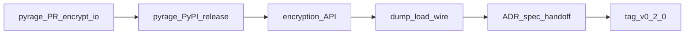

# Plan 4 — Streaming passphrase encryption (design)

> **Status:** Design accepted 2026-10-20 (Shawn). Not yet broken into execution
> tasks. REQUIRED when implementing: superpowers:subagent-driven-development or
> executing-plans.

**Goal:** Add streaming age encryption and decryption under a passphrase so
`l3io-wordpress-backup` can supersede ADR-0006 and share one `age` format for
archives (backup AD-26), without buffering multi-GB payloads (backup AD-21),
without hand-rolling crypto, and without putting the passphrase on argv.

**Target release:** `0.2.0` (additive encryption API; bump `encryption` extra's
pyrage floor once upstream ships).

**Architecture:** Contribute streaming IO to `pyrage`'s `passphrase` module
(rage already streams via `Encryptor::with_user_passphrase` + `wrap_output`;
today's Python API only buffers into `bytes`). Then expose a passphrase path in
this package that mirrors the recipient path: lazy import behind the
`encryption` extra, stock `age -d` decryptable (scrypt recipient as sole
stanza), `DecryptionError` vs `CorruptDumpError`, wired through `dump`/`load`.

**Rejected:** buffering via `pyrage.passphrase.encrypt`/`decrypt`; hand-rolling
scrypt + STREAM; subprocess to the stock `age` CLI for passphrase (TTY-only /
no safe secret channel — see also kassiber's abandoned path).

**Spec:** amend `_bmad-output/planning-artifacts/spec/2026-10-12-l3io-wordpress-database-design.md`
§7.3 encryption, §6 codes, §9 CLI, §12 extras. **ADR:** amend
`docs/adr/0003-age-encryption.md`.

**Depends on (external):** a released `pyrage` that exports
`pyrage.passphrase.encrypt_io` / `decrypt_io` (or equivalent). This plan owns
that upstream work.

---

## Decision record

| Decision | Choice |
|---|---|
| Delivery vehicle | Contribute streaming passphrase IO to [woodruffw/pyrage](https://github.com/woodruffw/pyrage), then bump this package |
| Format | Standard age v1 with scrypt recipient as the **sole** recipient (stock `age -d` / `age -d -p`) |
| Package API | Keyword `passphrase=` mutually exclusive with `recipients=` / `identities=` |
| Public surface | Re-export `encrypt`, `decrypt`, `check_recipients`, `check_passphrase` from the package root (with `generate_identity`); covered by the API-surface / `__all__` guard. Backup may also import `l3io.wp.database.encryption` — that module is public, not `_`-private — but the supported import for new code is the root. |
| Secrets | Passphrase never on argv, never in logs/spans/exception messages/`repr`; same rules as §2.4 |
| Finding when encrypted and neither secret | Keep `IDENTITY_REQUIRED`; widen message to "supply identities= or passphrase=" (no new code in 0.2.0) |
| CLI | Library is the contract for backup. CLI gains a passphrase path that never puts the secret on argv (file or TTY; details in execution plan) |
| Version | `0.2.0`; `encryption` extra becomes `pyrage>=X,<2` where X is the first release with streaming passphrase IO |

---

## Part A — Upstream pyrage

Rage already supports the construction; `src/passphrase.rs` today writes into a
`Vec<u8>`. Add IO variants by mirroring `encrypt_io` / `decrypt_io` in `lib.rs`:

```rust
// passphrase.rs — sketch
#[pyfunction]
#[pyo3(signature = (reader, writer, passphrase, armored=false))]
fn encrypt_io(reader: Py<PyAny>, writer: Py<PyAny>, passphrase: &str, armored: bool) -> PyResult<()> {
    // PyFileLikeObject + BufReader/BufWriter
    // Encryptor::with_user_passphrase(passphrase.into())
    // wrap_output(ArmoredWriter::...) ; io::copy ; finish
}

#[pyfunction]
fn decrypt_io(reader: Py<PyAny>, writer: Py<PyAny>, passphrase: &str) -> PyResult<()> {
    // Decryptor::new_buffered(ArmoredReader::...)
    // decrypt(iter::once(&scrypt::Identity::new(passphrase.into()) as _))
    // io::copy
}
```

**Acceptance for the pyrage PR:**

1. Round-trip a multi-chunk stream (not only small `bytes`).
2. Peak RSS stays flat while encrypting a large synthetic reader (prove streaming).
3. Output decrypts with stock `age -d` (passphrase prompt).
4. Wrong passphrase → `DecryptError`; truncated body → distinct failure mode the
   Python layer can map.
5. Existing `passphrase.encrypt` / `decrypt` unchanged.

**Risk:** PR review latency. Mitigation: open the PR early; **do not block
Epic 2 on PyPI** — pin the fork tip under `[tool.uv.sources]` for development
(same strip-before-publish rule as config). Recording PyPI floor `X` and
removing the pyrage source pin remain a **0.2.0 publish precondition**, not an
Epic 2 start gate. No git-pin of pyrage in published metadata
(`uv build --no-sources` / `check_dist_metadata`).

---

## Part B — This package's API

Backup encrypts an **archive** (its own tar stream), not only a dump, so the
stream-level primitives are a first-class public API — not dump-only helpers.

### Public imports (0.2.0)

```python
from l3io.wp.database import (
    encrypt,
    decrypt,
    check_recipients,
    check_passphrase,
    generate_identity,
)
```

These are added to `__all__` and asserted by the existing API-surface / export
guards (same pattern as `generate_identity` today). `l3io.wp.database.encryption`
remains a public module (no leading `_`); importing from it is allowed, but the
documented path for new callers is the package root.

### `encryption.py`

```python
def encrypt(
    reader: IO[bytes],
    writer: IO[bytes],
    recipients: Sequence[str] | None = None,
    *,
    passphrase: str | None = None,
) -> None:
    """Stream reader into writer as age.

    Exactly one of recipients or passphrase. Passphrase mode emits a sole
    scrypt recipient (stock ``age -d``). Suitable for any byte stream (dumps
    or caller-built archives).
    """

def decrypt(
    reader: IO[bytes],
    writer: IO[bytes],
    identities: Sequence[str] | None = None,
    *,
    passphrase: str | None = None,
) -> None:
    """Stream an age reader into writer as plaintext.

    Exactly one of identities or passphrase.
    """

def check_passphrase(passphrase: str) -> None:
    """Refuse a passphrase encrypt could not use, before any data moves."""
```

Rules:

- Both set, or neither set → `InvalidArgumentsError`.
- Empty passphrase → `InvalidArgumentsError`.
- Wrong passphrase → `DecryptionError` (not `CorruptDumpError`).
- Truncated / non-age / damaged body → `CorruptDumpError`.
- Passphrase value never appears in exception messages.
- Lazy `import pyrage` unchanged; require the IO APIs and raise
  `MissingDependencyError` (or a clear `InvalidArgumentsError` naming the
  pyrage floor) if only one-shot passphrase exists — should not happen once
  the extra bound is correct.

### `transfer.py` / `facade.py` / `cli.py`

```python
def dump(..., *, recipients=None, passphrase=None, options=())
def iter_dump(..., *, recipients=None, passphrase=None, options=())
def check_dump(..., *, recipients=None, passphrase=None, options=())
def load(..., *, replace=None, identities=None, passphrase=None, options=(), allow_unsandboxed=False)
def check_load(..., *, source=None, replace=None, identities=None, passphrase=None, options=(), allow_unsandboxed=False)
```

- Mutex recipients/passphrase on dump; identities/passphrase on load.
- `_prepare` / `_Decrypting`: passphrase path uses `encryption.decrypt(..., passphrase=)`.
- Encrypted head + neither secret → `Finding(Code.IDENTITY_REQUIRED, "the source is age-encrypted; supply identities= or passphrase=")`.
- `_Header.needs_identity` stays the flag name (means "needs a decryption secret"); docstring updated.

### Verdict / errors

- No new `Code` in 0.2.0 unless header parsing of stanza type is added later.
- `DecryptionError` docstring: wrong identity **or** wrong passphrase.
- `MissingDependencyError` still names the `encryption` extra.

### CLI (thin)

- Dump: `--passphrase-file PATH` or interactive prompt; never `--passphrase SECRET`.
- Load: same.
- Mutex with `--recipient` / `--identity`.
- Backup does **not** need the CLI; it calls `dump`/`load` / `encrypt`/`decrypt` with `passphrase=` from its own AD-26 chain.

---

## Part C — Spec and ADR amendments (applied when implementing)

1. **ADR-0003:** passphrase is a first-class streaming mode; scrypt sole recipient;
   stock `age -d`; pyrage floor raised; mutex with recipients/identities.
2. **Spec §7.3:** document `passphrase=` on encrypt/decrypt/dump/load; mutex;
   error split; operator recovery via `age -d`.
3. **Spec §6:** `IDENTITY_REQUIRED` message includes passphrase.
4. **Spec §12:** `encryption` extra pyrage lower bound.
5. **Spec §13 / tests:** peak-RSS (or chunked-reader) proof for passphrase path;
   round-trip with stock `age -d` in CI when `age` is on PATH (skip if absent);
   wrong passphrase → `DecryptionError`.

---

## Part D — Test plan (this package)

| Test | Proves |
|---|---|
| Passphrase round-trip through `encrypt`/`decrypt` | API works |
| `dump(..., passphrase=)` → `load(..., passphrase=)` | transfer wiring |
| Mutex violations raise `InvalidArgumentsError` | exclusive modes |
| Wrong passphrase → `DecryptionError`; truncate → `CorruptDumpError` | error split |
| Output decrypts with `age -d` (subprocess, passphrase via its supported non-argv channel or expect script) | ADR-0003 operator recovery |
| Large streaming reader (chunk generator, not one `bytes`) completes without holding the whole plaintext | streaming |
| Optional slow: peak RSS ceiling against an oversized fixture (mirror backup AD-21 intent; size TBD with Shawn) | bounded memory |
| `IDENTITY_REQUIRED` when encrypted and neither secret | check_load / load gate |
| Base install still forbids `pyrage` | extra boundary |

---

## Part E — Work sequence



1. Open pyrage PR; git-pin under `[tool.uv.sources]` to unblock Epic 2. PyPI
   floor `X` is a 0.2.0 publish precondition (not an Epic 2 start gate).
2. Branch `feat/plan-4-passphrase-stream` from `main`.
3. Raise `encryption` extra bound; implement `encryption.py` passphrase path test-first.
4. Wire `transfer` / `facade` / CLI; update `IDENTITY_REQUIRED` message.
5. Amend ADR-0003, spec, README, handoff; tell backup 0.2.0 is ready to pin.
6. Shawn releases 0.2.0 (same publish path as 0.1.0).

---

## Out of scope for 0.2.0

- Backup's AD-26 passphrase chain (lives in backup; calls our `passphrase=`).
- Combining passphrase with recipients (forbidden by age; refuse loudly).
- Parsing age stanzas to emit a distinct `PASSPHRASE_REQUIRED` code.
- Publishing pyrage ourselves (Shawn / upstream maintainer).
- Changing Exit code table (6 stays reserved for the family).

---

## Handoff note for backup (once 0.2.0 ships)

Pin `l3io-wordpress-database[encryption]>=0.2,<0.3`. For archives, import
`encrypt` / `decrypt` / `check_passphrase` from `l3io.wp.database` (root). For
dumps, `dump(..., passphrase=)` / `load(..., passphrase=)` remain available.
Do not build an age argv or option file. Supersede backup ADR-0006 against
ADR-0003 as amended.